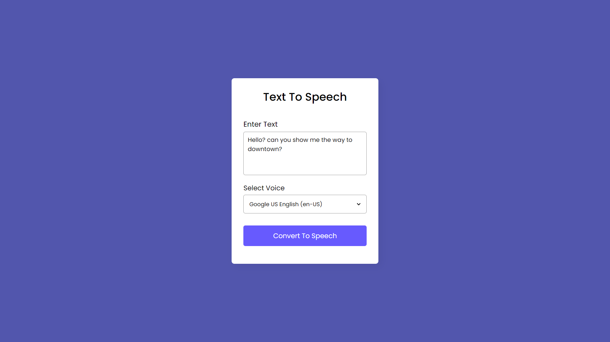

# Text to Speech

Type text and have the browser read it aloud.

## Features

- Uses the Web Speech API (speechSynthesis)
- Pick any voice installed on the device
- Pause and resume speech

## Run it

No build step. Open `index.html` in a browser, or serve the folder with any static server, for example `python -m http.server`.

## Screenshots

